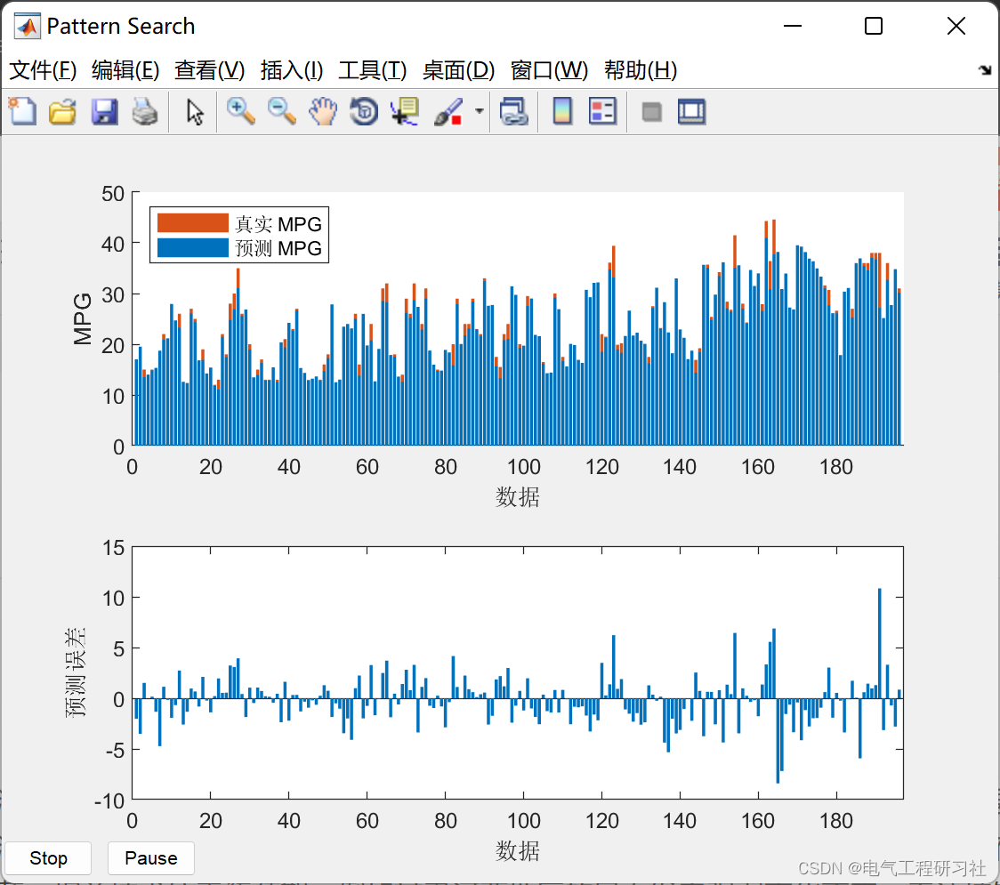
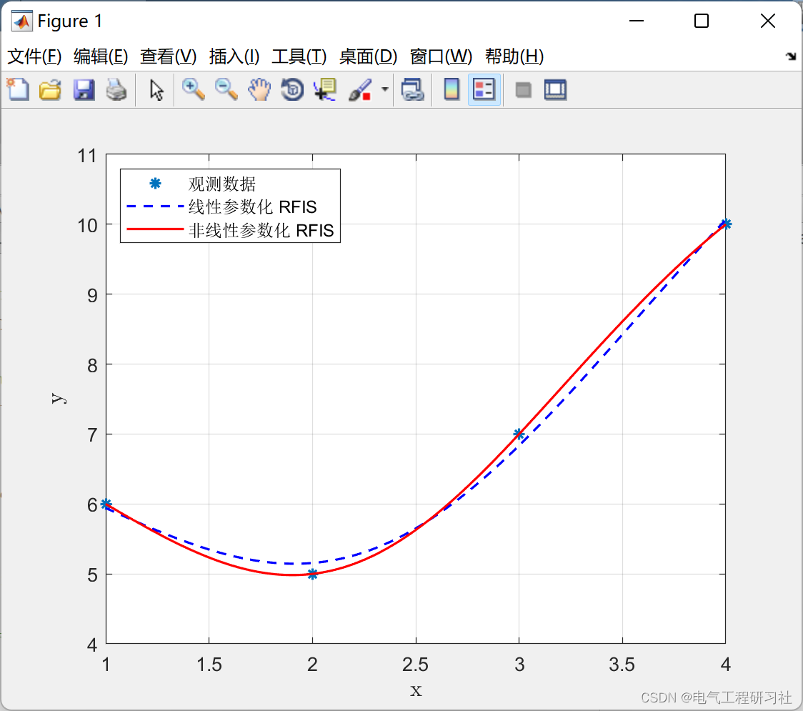
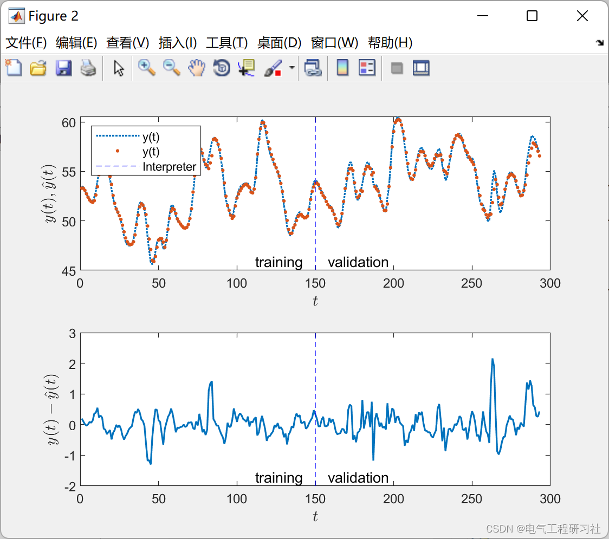
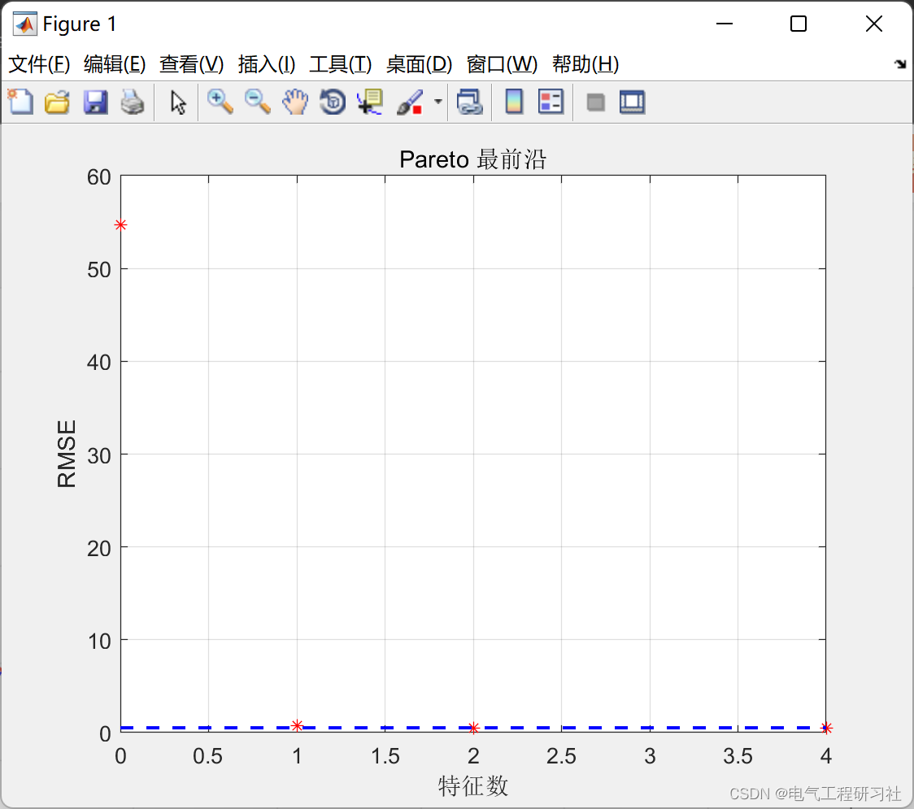
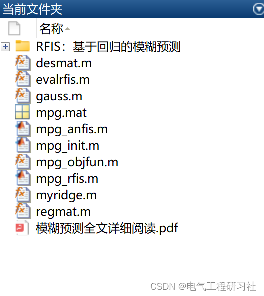

# Fuzzy Prediction | Comparison of RFIS and ANFIS Fuzzy Models (Matlab Code Implementation)

1. Overview of energy as an important material foundation for the national economy and social development, a crucial support for building strong industrial provinces, culturally rich provinces, and ecological civilization-strong provinces, and a starting point for promoting the transformation of economic development modes and economic structural adjustment. However, the problems with new energy from the current development situation are also quite significant, with related technologies at a bottleneck period, such as the instability and uncontrollable changes in wind power generation in the Hexi region of Gansu, as well as high operational costs, storage difficulties, randomness, and intermittency. This paper compares the prediction of RFIS and ANFIS fuzzy models.
This article introduces a new multivariate fuzzy inference system without explicit definition of fuzzy rules. The system uses Gaussian fuzzy sets as inputs and linear and nonlinear parameterized system functions. To determine their parameters, linear and nonlinear regression is used. Linear regression is realized by Ridge Regression, while nonlinear regression is implemented by Levenberg-Marquardt algorithm. The input fuzzy set is determined by a multi-objective genetic algorithm with feature selection methods. In the case of linear parameterized system functions, consider the following methods: F test, ReliefF, regression tree, neighborhood component analysis, and lasso regression. In the case of nonlinear parameterized system functions, the terms in the so-called item matrix are encoded in an individual and selected using a genetic algorithm. In this article, two pairs of objective functions are defined: one pair, consisting of the number of active predictors and root mean square error, used to construct fuzzy estimates, and the second pair, consisting of the number of active predictors and confusion values, used to construct fuzzy classifiers. These multi-criteria objective functions can select models from the Pareto frontier, considering the trade-off between model accuracy and its simplification. The proposed method was tested on four examples: approximation of single variable functions, binary classification of currency bills, prediction of time series, and prediction of automobile fuel consumption. The experiments conducted confirmed the effectiveness of the proposed solution.
2 Mathematical Model
Here are only two formulas, the details of the rest are described in Part 4.
3. Editing of RFIS and ANFIS Fuzzy Model Prediction Results
Editor
Editor
Editor
4. Matlab code and article detailed reading. This article only displays a part of the code, all codes can be found in:
Editor
figure(1)
5. References [1] Jia Tingting. Intelligent Wind Energy Storage Supervision System Based on Fuzzy Predictive Control [J]. Science and Innovation and Application, 2022, 12(16): 42-45. DOI: 10.19981/j.CN23-1581/G3.2022.16.008.
[2] Tang Wanbao. Predictive Dynamic Multi-Objective Optimization Algorithm [D]. China University of Mining and Technology, 2021. DOI: 10.27623/d.cnki.gzkyu.2021.001203.
[3] Aghaeipoor F, Javidi MM (2019) MOKBL?MOMs: an inter-  
pretable multi-objective evolutionary fuzzy system for learning  
High-dimensional regression data. Inform Sci 496:1–24  
6 End Notes

## Images

<!-- PAYMENT_BLOCK -->

## Get this dataset

- Payment link (Stripe): [Buy now](https://buy.stripe.com/3cs8yP7sY87d0vu9AB)
- Payment QR code: 

<!-- /PAYMENT_BLOCK -->
